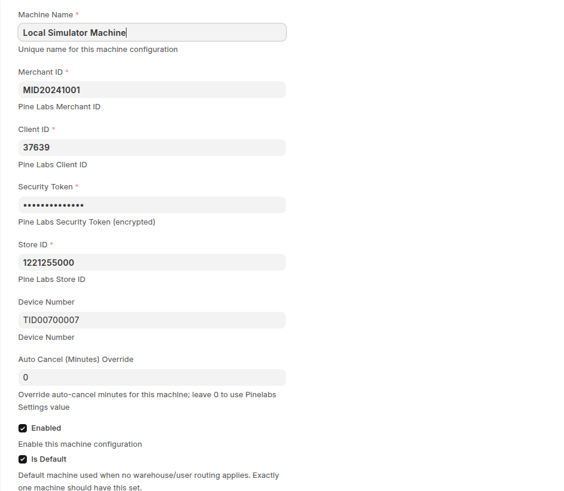
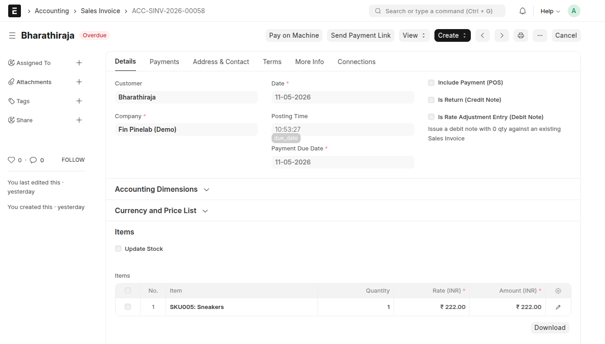
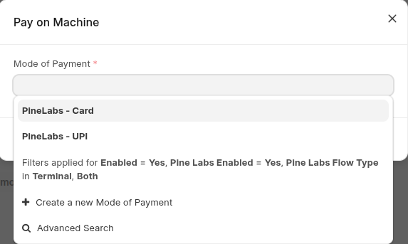
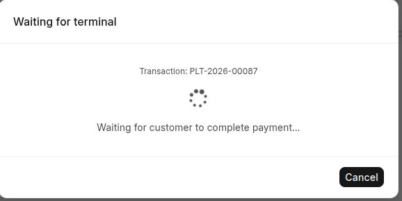
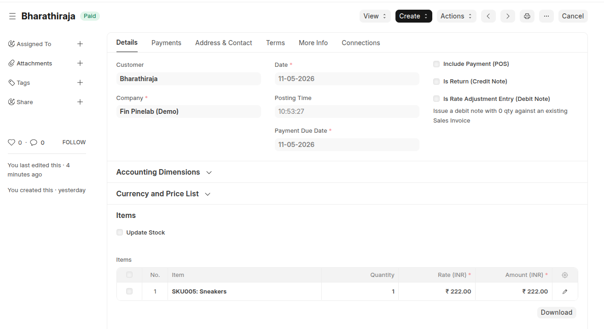
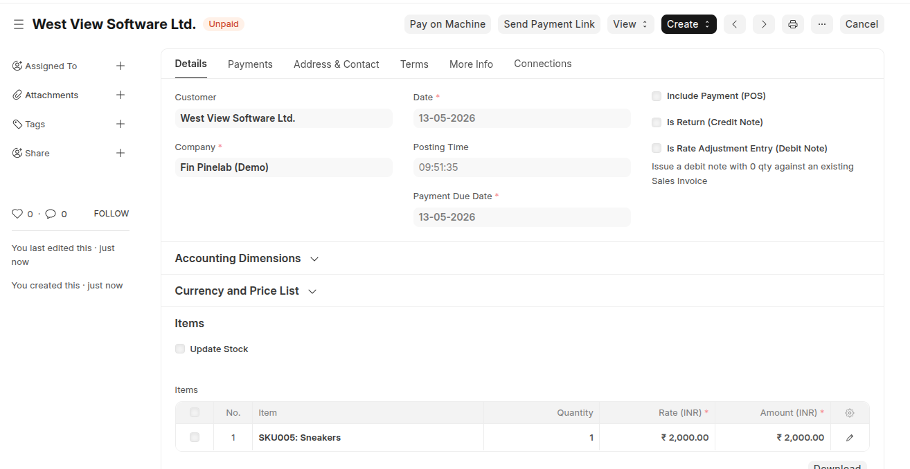
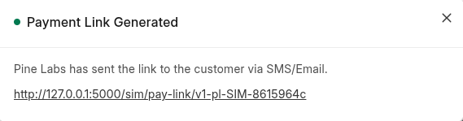
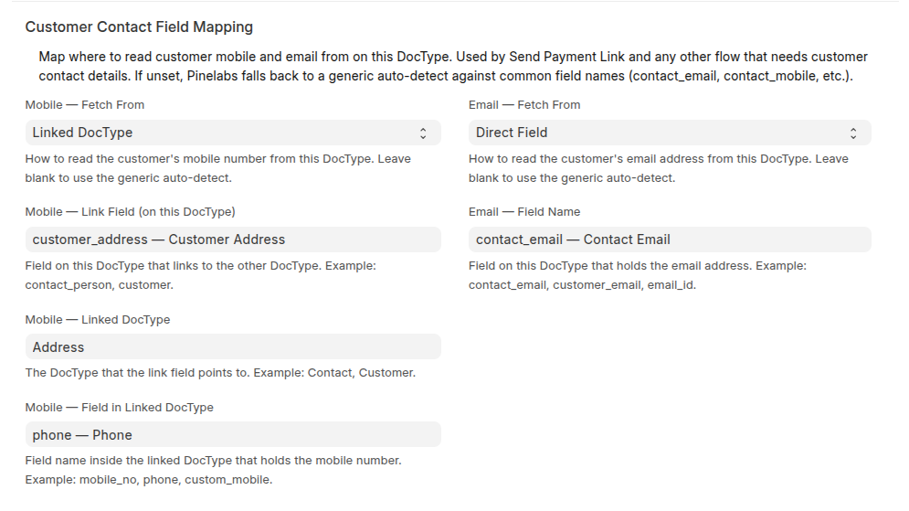

# pinelabs_fin — guide

A short walkthrough: install the app, configure it once, take your first payment.

## What this guide covers

1. **Install** — `bench` commands to put the app on your site
2. **First-time setup** — connect your Pine Labs machine and pick which doctypes can be paid
3. **Pay on Machine** — take a payment when the customer is in front of you
4. **Send Payment Link** — collect from a remote customer via SMS / email
5. **Using the API** — call the same flows from your own button or code

---

## 1. Install

### What you need

| Thing | Minimum version | Notes |
|---|---|---|
| Frappe | 15.x | |
| ERPNext | 15.x | Must be installed |
| Python | 3.10 or newer | |
| MariaDB | 10.6+ with InnoDB | Needed so the app can lock rows safely |

> **Note:** To check your ERPNext version, run `bench --site <your-site> list-apps`.

### Install steps

Open a terminal in your bench folder and run:

```bash
cd ~/frappe-bench
bench get-app https://github.com/<owner>/pinelabs_fin
bench --site <your-site> install-app pinelabs_fin
bench --site <your-site> migrate
```

---

## 2. First-time setup

Everything in this section is done once, in **Pinelabs Settings**. Open the desk Awesome Bar and type "Pinelabs Settings" to find it.

<div class="keep-together" markdown="1">

### Configure your Pine Labs machine

Open **Pinelabs Settings → Machines** and add one row per terminal:



</div>

| Field | What to put |
|---|---|
| **Machine Name** | Any short label you choose (e.g. "Front counter") |
| **Client ID**, **Security Token**, **Merchant ID**, **Store ID**, **Terminal ID** | Copy from the welcome email Pine Labs sent you |
| **Enabled** | ✅ |
| **Is Default** | ✅ on **exactly one** machine |

Save. That's it — the app can now talk to your terminal.

<div class="keep-together" markdown="1">

### Payable Documents — which doctypes can be paid

In **Pinelabs Settings → Payable Documents**, add one row per ERPNext doctype that should show the payment buttons (Sales Invoice, POS Invoice, Payment Request, etc.).


</div>

For each row, fill in:

| Field | What to put |
|---|---|
| **DocType** | The source doctype name (e.g. `Sales Invoice`) |
| **Enabled** | ✅ |
| **Pay on Machine** | ✅ to show the terminal button |
| **Send Payment Link** | ✅ to show the payment-link button |
| **Amount Field** | The field that holds the payable amount (e.g. `base_grand_total`) |
| **Create Payment Entry** | ✅ |

Save. Open any submitted record of that doctype — the two buttons appear at the top of the form.



---

## 3. Pay on Machine (terminal)

### When to use it

The customer is **standing in front of you** and ready to tap a card or scan UPI on the Pine Labs machine.

### How to use it

1. Open the submitted Sales Invoice in ERPNext.
2. Click **Pay on Machine** at the top of the page.

<div class="keep-together" markdown="1">

3. A small window opens. Pick **PineLabs - Card** or **PineLabs - UPI**.

   

</div>

4. Click **Start Payment**.

<div class="keep-together" markdown="1">

5. A "Waiting for terminal" window appears and the Pine Labs machine beeps with the bill.

   

</div>

6. The customer taps their card or scans UPI.
7. The window changes to "Payment SUCCESS" and closes by itself.

<div class="keep-together" markdown="1">

8. The invoice refreshes — the status badge flips to **Paid**, Outstanding is 0, and a new Payment Entry shows under **Payments**.

   

</div>

End-to-end this takes about 5–10 seconds.

---

## 4. Send Payment Link (online)

### When to use it

The customer is **not in front of you** — phone order, remote customer, advance payment. They pay later from their own phone.

### How to use it

1. Open the submitted invoice in ERPNext.
2. Make sure the customer has an **email** or a **mobile number** filled in.

<div class="keep-together" markdown="1">

3. Click **Send Payment Link** at the top.

   

</div>

<div class="keep-together" markdown="1">

4. A green popup shows the link.

   

</div>

5. Pine Labs sends the link to the customer by SMS and email automatically.
6. The customer opens the link and pays from their phone.
7. The invoice flips to **Paid** within a minute of payment.

### Customer Contact Field Mapping

The app needs the customer's email and mobile to give to Pine Labs. In the Payable Documents row, scroll down to **Customer Contact Field Mapping** and tell the app where to find these values:



There are two ways to point at a value:

- **Direct Field** — the value sits on the source doctype itself (e.g. an `email_id` field directly on Sales Invoice).
- **Linked DocType** — the value sits on another doctype that the source links to (e.g. mobile is on the Address linked via `customer_address` → field `phone`).

Mobile and Email are independent — pick whichever mode fits each one. Leave them blank to let the app auto-detect common field names (`mobile_no`, `email_id`, `contact_email`, etc.).

---

## 5. Using the API

If you want to take a Pine Labs payment from your own button — or from any other code (server hook, external system) — call one of these three whitelisted APIs.

### Pay on Machine

```python
pinelabs_fin.api.terminal.initiate_terminal_payment(
    reference_doctype,    # required — e.g. "Sales Invoice"
    reference_name,       # required — e.g. "ACC-SINV-2026-00054"
    mode_of_payment,      # required — a PineLabs-enabled Mode of Payment
    amount=None,          # optional — defaults to source doc's outstanding
)
```

Starts a terminal payment. The machine beeps with the bill; customer taps card or scans UPI. Returns `{ success, transaction_name, status }`.

### Send Payment Link

```python
pinelabs_fin.api.plural.initiate_payment_link(
    reference_doctype,        # required
    reference_name,           # required
    flow="all_methods",       # optional — "all_methods" / "upi_only" / "card_only"
    expiry_minutes=None,      # optional — defaults to 1440 (24 h)
    customer_email=None,      # optional — inline override; skips Customer Contact Field Mapping
    customer_mobile=None,     # optional — inline override; skips Customer Contact Field Mapping
)
```

Generates a Plural payment link. Pine Labs delivers it by SMS and email automatically. Returns `{ success, transaction_name, payment_link_url }`.

### Check Pay on Machine status

```python
pinelabs_fin.api.terminal.check_terminal_status(
    transaction_name,    # required — the PLT-... from initiate_terminal_payment
)
```

Used to poll during a Pay on Machine flow. Stop once `status` is one of `SUCCESS`, `FAILED`, or `CANCELLED`. Returns `{ status, payment_id, payment_method, error_message }`.

### Easy way to call from JS

The app exposes two helpers on `frappe.pinelabs.*` that do the API call **and** open the standard UI (the locked "Waiting for terminal" modal for the terminal flow, the green "Payment Link Generated" popup for the link flow):

```javascript
// Pay on Machine
frappe.pinelabs.start_terminal_payment(
  { reference_doctype: frm.doctype, reference_name: frm.docname, mode_of_payment: "PineLabs - Card" },
  { on_settled: () => frm.reload_doc() },
);

// Send Payment Link
frappe.pinelabs.start_payment_link(
  { reference_doctype: frm.doctype, reference_name: frm.docname, flow: "all_methods" },
  { on_link: () => frm.reload_doc() },
);
```

That's all you need to wire up a custom payment button.
